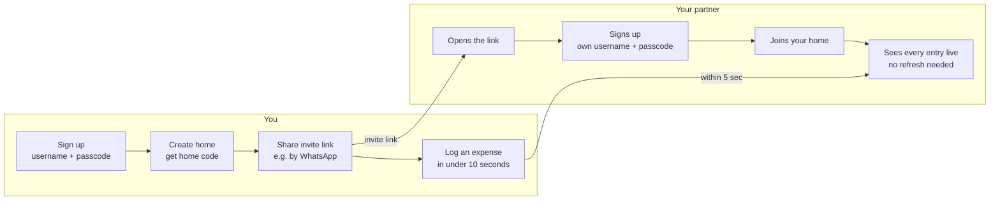

# Couple Money Tracker — App Spec & Build Plan

Oct 16, 2026 · @Martino Cornelius · updated Oct 17, 2026

## Overview

Couple Money Tracker (working name) helps couples and their families manage money together and save for their dreams. Each person signs up with a username and passcode, then creates a home or joins one with a home code or invite link. Members log income, expenses and transfers into shared pockets, see every entry within seconds, and always know where their money came from, where it went and how close they are to each savings goal. It runs in any browser, so there is no app to install.

- **Who it's for:** couples, and the family members they invite, who share household money and want to see spending as it happens, not at the end of the month. Any family can sign up and make its own home; homes never see each other's data.
- **Main goal:** logging a transaction takes under 10 seconds, so both partners actually do it every day.
- **Saving goal:** every couple can see how close they are to each dream, and how much to set aside each month to get there on time.
- **MVP success:** every member uses it daily for 2 weeks without falling back to notes or spreadsheets.
- **Currency:** Indonesian Rupiah, shown as Rp 25.000 (whole rupiah, no decimals).
- **Time zone:** Western Indonesia Time (WIB, UTC+7) decides "today", "this month" and when recurring entries are recorded.
- **Interface language:** English for the MVP. Open question: add Bahasa Indonesia later?
- **App admin:** Martino, the app owner. The admin can reset a forgotten passcode, but can never see anyone's passcode or any home's money.

## MVP scope

The first version does these things and nothing else, in the phone or laptop browser.

**Accounts and homes**

1. **Sign up and log in:** a landing page explains the app and offers Sign up and Log in. Signing up takes a username and a passcode (6 or more characters). Each browser stays logged in until you log out or don't use the app for 90 days, so there is nothing to type each day.
2. **Create or join a home:** after signing up, you create a home and get its 12-character home code and invite link, or you join a home by opening an invite link or typing a home code. Your spouse and family sign up with their own username and passcode, then join the same way. An account belongs to one home at a time, and every member can log income, expenses and transfers.
3. **Passcode reset by the admin:** someone who forgets their passcode asks the admin (for example on WhatsApp). The admin resets it on the Admin screen and gets a one-time passcode, valid for 24 hours, to send them. They log in with it and must choose a new passcode. Passcodes are stored scrambled (hashed), so nobody, not even the admin, can ever see one.

**Knowing where money comes from and goes**

4. **Pockets:** the places your money sits, such as a bank account, cash or an e-wallet. A bank account pocket requires a bank name and account number (rekening); other types never ask for one. Each pocket shows its current balance.
5. **Categories:** every home starts with income and expense categories made for Indonesian households (see Default categories below). Any member can add their own with a name and an emoji, rename them, or hide the ones they don't use, in Home settings.
6. **Add a transaction fast:** income, expense or transfer, amount, pocket, category, optional note, date (defaults to now). A transfer moves money between two of your pockets, such as an ATM withdrawal from a bank pocket to cash, or money set aside in a goal pocket. It changes both balances but never counts as income or expense.
7. **Recurring entries:** any income, expense or transfer can repeat every month on a chosen day, such as salary on the 25th, rent on the 1st, or Rp 750.000 into the Bali trip pocket on the 26th. The app records each one on its day by itself, so nothing is forgotten.
8. **Shared live feed:** every member's transactions in one list, each labeled with who logged it, plus today's and this month's income, expense and balance. New entries appear on every open phone within about 5 seconds, without refreshing.
9. **Net worth and balance check:** Home shows your net worth: everything in your pockets plus money owed to you, minus money you owe. When a pocket doesn't match the real balance in your bank app, Adjust balance fixes it, and the monthly summary shows how much money moved without being logged.
10. **Payables and receivables:** record money the family owes (payable, hutang) and money owed to the family (receivable, piutang) with the counterparty, amount and expected payment date. Overdue and due-soon items stand out. Marking one paid records the matching transaction in a pocket.

**Planning and saving**

11. **Savings goals:** any pocket can hold a dream: a target amount and, if you like, a target date, such as Bali trip Rp 20.000.000 by December 2027. The app shows how far along you are and how much to save each month to get there on time. Home has an "Our dreams" card with every goal.
12. **Monthly budgets per category:** any member can set a monthly spending limit for an expense category, such as Food and drinks Rp 3.000.000. A budget is optional and repeats every month. Home shows how much of each budget this month's expenses have used: amber from 80%, red when over.
13. **Monthly summary, charts and insights:** pick a month to see its income, expense and savings; a pie chart of how much each category contributed to that month's expense or income; a line chart of income and expense (or one category) going up and down over the last 3 or 6 months; a comparison with the month before; and up to four plain-language insights such as "Food and drinks: 18% more than last month". The app works the insights out with fixed rules (see Monthly insights below); no AI or outside service is involved.
14. **Export to Excel:** any member can download the home's transactions for a chosen period as an Excel file (.xlsx) that opens in Excel or Google Sheets: one sheet lists every transaction, another has monthly totals per category.

**Later list** (not in the MVP):

- **Email sign-in (the planned next upgrade):** every account adds an email address and confirms it with a verification link sent to that address; accounts without one are asked to add it on their next visit. Log in then uses email + passcode, and a forgotten passcode is reset through an emailed link, so the admin reset becomes a fallback. Usernames stay as the names members see. Needs an email-sending service (chosen when this is built) and two new users fields: email and email_verified_at.
- Quick lock: ask for the passcode again each time the app is reopened (optional per device)
- Spam protection on sign-up (e.g. Cloudflare Turnstile)
- One account in more than one home
- Instant updates without the 5-second check
- Partial payments on payables and receivables
- Reminders before an expected payment date
- Push notifications when a member logs something
- Charts that look further back than 6 months (e.g. yearly trends, net worth over time)
- Financial freedom number: 25 × a year's expenses, and how close your net worth is to it
- Recurring entries that repeat weekly or yearly (the MVP repeats monthly)
- Receipt photos
- Private entries (for gift surprises)
- Bahasa Indonesia interface
- Bank account syncing

## Screens

The MVP has sixteen screens, all designed phone-first (375 px wide). A bottom tab bar links Home, Pockets, Payables & receivables and Settings, with a + button for new entries. Screens 1 to 5 come before you are in a home and have no tab bar.

| #   | Screen                           | What it shows | What you can do |
| --- | -------------------------------- | ------------- | --------------- |
| 1   | Landing                          | What the app does in one line ("Track money together. Save for your dreams."); shown when this browser isn't logged in | Sign up; log in |
| 2   | Sign up                          | Username, passcode and repeat passcode; a tip not to reuse your bank PIN | Create the account; switch to Log in |
| 3   | Log in                           | Username and passcode; "Forgot your passcode? Ask the app admin to reset it." | Log in; after an admin reset, choose a new passcode |
| 4   | Create or join a home            | Shown after logging in when your account isn't in a home; your username | Create a home (home name) or enter a home code; change your passcode; log out; open Admin (admin only) |
| 5   | Join a home                      | The home's name and its members (opened from an invite link, or after entering a home code) | Tap Join; if you aren't logged in yet, sign up or log in first and come back here |
| 6   | Home (shared feed)               | Net worth; this month's income, expense and balance; "Our dreams" (each goal's progress); payables and receivables due in the next 7 days; this month's budgets (spent vs. limit per category); transaction list with amount, pocket, category, note, who logged it and time, transfers shown as "BCA → Cash", recurring entries marked with a repeat icon | Switch between Today and This month; filter by pocket; tap + to add; tap your own entry to edit; open the monthly summary |
| 7   | Add / edit transaction           | Expense, Income or Transfer toggle (Expense by default), large amount field, pocket picker (remembers your last pocket; From and To for a transfer), category grid (your home's visible categories; not for transfers), note, date and time, "Repeat every month" switch with the day of the month | Save; edit or delete your own entries only |
| 8   | Pockets                          | Every pocket with its type and current balance; bank pockets also show the bank name and a masked account number (•••• 1234); pockets with a goal show a progress bar and how much to save per month | Add a pocket; open one to see its transactions; reveal or copy an account number; adjust the balance to match your bank app |
| 9   | Add / edit pocket                | Name, type (Bank account, Cash, E-wallet, Other), opening balance; bank name and account number fields appear only when the type is Bank account; optional savings goal: target amount and target date | Save; archive a pocket you no longer use |
| 10  | Payables & receivables           | Two tabs: Payables (the family owes) and Receivables (owed to the family); each item's counterparty, amount and expected payment date; overdue items in red, due within 7 days in amber; open total per tab | Add an item; mark one as paid; switch between Open and Paid |
| 11  | Add / edit payable or receivable | Payable or Receivable toggle, counterparty, amount, expected payment date, note | Save; when marking paid, pick a pocket and date, and the matching transaction is recorded |
| 12  | Home settings                    | Home name, members, home code, invite link and monthly budget per expense category; your username; links to Categories, Recurring entries and, for the admin only, Admin | Copy or share the invite link (WhatsApp-friendly text); reset the home code; remove a member; set, change or clear a category's monthly budget; change your passcode; log out; leave the home |
| 13  | Recurring entries                | Every monthly rule: type, amount, pocket (or From → To), category, day of the month, next date and who set it up | Add; edit; pause or resume; delete (entries already recorded stay) |
| 14  | Monthly summary and charts       | One month's income, expense and savings (income − expense, and as % of income); a chart card with two views, Categories (pie chart with the full category list below) and Trend (line chart with a table below), as the Charts section says; change vs. the month before; budget results; unrecorded money (that month's balance adjustments); up to four insights | Pick the month (previous / next); switch between Categories and Trend, Expense and Income, 3 and 6 months; tap a slice, a month or a category for details; export to Excel; open it from a "See monthly summary" link on Home |
| 15  | Admin (app admin only)           | Opened from Home settings or Create or join a home. Find an account by username: when it was made and whether it is locked; never a passcode, and never any home's money | Reset the passcode: shows a one-time passcode once, valid for 24 hours |
| 16  | Categories                       | Opened from Home settings. Two tabs, Expense and Income: every category with its emoji, built-in ones marked, hidden ones at the bottom | Add a category (name + emoji); rename it or change its emoji; hide it or show it again (built-in ones can't be renamed or hidden) |

**Default categories.** Every new home starts with this list, made for Indonesian households. Any member can add their own, rename them or hide the ones they don't use (screen 16). Built-in categories can't be renamed or hidden: payables and receivables use the debt ones, and Other is always there as a fallback. Transfers and balance adjustments have no category.

| Expense | Income |
| --- | --- |
| 🍜 Food and drinks (eating out, coffee, snacks) | 💼 Salary |
| 🛒 Groceries | 🎉 Bonus and THR |
| 🏠 Housing (rent, mortgage/KPR, repairs) | 🏪 Business income |
| 💡 Bills and utilities (electricity, water, internet, phone credit) | 💻 Side income (freelance, online selling) |
| 🚗 Transport (fuel, ojek online, parking, toll) | 📈 Investment returns (interest, dividends, gold, mutual funds) |
| 🧹 Household (household help, laundry, cleaning) | 🏘️ Rental income |
| 👶 Kids and education | 🎁 Gifts received (angpao, wedding gifts) |
| 🏥 Health (doctor, medicine, BPJS) | ↩️ Refunds and cashback |
| 🛡️ Insurance | 🤝 Debt received (built-in) |
| 🛍️ Shopping | 📦 Other (built-in) |
| 💅 Personal care | |
| 🎬 Entertainment and hobbies | |
| ✈️ Travel | |
| 👪 Family support (money for parents and relatives) | |
| 💝 Gifts and donations (zakat, offerings, kondangan) | |
| 💳 Debt payment (built-in; installments/cicilan go here too) | |
| 📦 Other (built-in) | |

The words in brackets are examples to help choose; the category names are the words before them.

**Savings goal maths** (screens 6 and 8). Progress is the pocket's balance ÷ the target. With a target date, "save per month" is (target − balance) ÷ months left, rounded up to the next Rp 1.000, where months left counts this month and the target month (October 2026 → December 2027 is 15 months). A goal whose balance reaches the target shows "Goal reached". A goal past its date shows how much is still missing.

**Charts** (screen 14). Only income and expense entries appear in charts; transfers and balance adjustments never do.

- **Categories view (pie chart):** the chosen month's expense or income (a switch), drawn as a ring, largest slice first, clockwise from the top. Up to six categories each get a slice; with more than six, the five largest get a slice and the rest are combined into one gray "Everything else" slice, so the pie never has more than six slices. Slices take the chart colors in a fixed order (blue, orange, aqua, yellow, pink, green), so the biggest slice is always blue. The middle of the ring shows the total, or the tapped slice's name, amount and share. Below the chart, a list shows every category that month, largest first, with its amount, its share (%) and its change from the month before; tapping a row or a slice shows that category's transactions. A month with fewer than three categories shows just the list, because a pie of one or two slices tells you nothing.
- **Trend view (line chart):** the 3 or 6 months up to the chosen month (a switch). It shows two lines, income and expense per month; a category picker switches to one line for a single category. The current month isn't finished, so it is labeled "so far" and joined with a dashed line. Tapping a month shows its numbers. A small table below the chart lists the same numbers (month, income, expense, saved).
- **Shortened amounts** appear only on the chart's axis: Rp 750 rb (ribu, thousand), Rp 5,2 jt (juta, million), Rp 1,2 M (miliar, billion). Everywhere else amounts are written in full (Rp 5.200.000).

**Excel export** (screen 14). Export to Excel asks for a period (this month, last month, last 3 months, last 6 months, this year, or everything) and downloads a file named like `couple-money-2026-08-01-to-2026-10-31.xlsx`, made in the browser from the home's own data. Two sheets:

- **Transactions:** one row per entry with date, type, category, amount, moved, pocket, to pocket, note, logged by and recurring (yes/no). Amount is positive for income and money found, negative for expenses and money missing; transfers leave Amount empty and show their amount under Moved. So the sum of the Amount column is the change in what you own over the period. Amounts are real numbers shown as Rupiah, so Excel can add them up.
- **Monthly totals:** one row per month and category, with the income or expense total.

**Monthly insights** (screen 14). The app checks these rules in this order and shows the first four that apply. Months run from the 1st to the last day; amounts are whole rupiah.

1. **Savings:** if income is more than expense, "You saved X% of your income" (rounded to a whole percent). If expense is more than income, "You spent Rp X more than you earned".
2. **Unrecorded money:** if the month's balance adjustments add up to less than zero, "Rp X left your pockets without being logged"; if they add up to more than zero, "Rp X arrived in your pockets without being logged".
3. **Over budget:** for each category over its budget, "Entertainment went over budget by Rp X".
4. **Biggest increase:** the expense category that grew the most in rupiah compared with the month before, if it grew by at least 20% and at least Rp 100.000: "Food and drinks: X% more than last month".
5. **Biggest decrease:** the expense category that shrank the most in rupiah, by the same thresholds: "Transport: X% less than last month".
6. **Top category:** "Groceries was X% of your spending".
7. **Largest expense:** "Largest expense: Rp X on Shopping (note, date)".

Only income and expense entries count toward income, expense, savings, budgets and every rule except rule 2; transfers only move money between your own pockets. The current month isn't finished, so its comparisons with the month before (in insights, the category list and the change figures) use the same days of that month, for example 1–18 October against 1–18 September. A month with no transactions shows "No transactions in this month yet" instead of insights. A rule that needs the month before is skipped when that month has no transactions.

## Key user flows

- **Joining:** you sign up, create the home and share the invite link (or read out the home code). Your partner opens it in their phone browser, signs up with their own username and passcode, and joins, with no app to install. Any member can log entries, and every open phone picks up new ones within about 5 seconds.
- **Saving for a dream:** add a pocket called "Bali trip 2027" with a goal of Rp 20.000.000 by December 2027. The app says how much to save each month; set up a recurring transfer for that amount from your salary pocket on payday. Home's "Our dreams" card shows the progress.
- **Forgotten passcode:** they message the admin. The admin confirms it's really them (for example with a call), opens Admin, finds their username, taps Reset passcode and sends them the one-time passcode privately. They log in with it within 24 hours and choose a new passcode; their other devices are logged out.
- **Balance check:** once a month, compare each pocket with your bank app. If they differ, tap Adjust balance and type the real balance. The monthly summary then shows how much moved without being logged, a nudge to log everything.

## Data model

Ten tables in one Cloudflare D1 database hold everything: users, sessions, homes, members, pockets, categories, transactions, recurring rules, payables and receivables, and budgets. Every record except users and sessions belongs to one home. Ids are random text, money is whole rupiah stored as integers, and dates are text in ISO format (2026-10-16T09:30) in WIB. A pocket's balance is calculated (opening balance + income − expenses + transfers in − transfers out + adjustments in that pocket), never stored. Net worth, goal progress, the monthly summary, its charts and insights, and Excel exports are also calculated each time; nothing extra is stored.

**users** — one row per account

| Field                | Type    | Notes |
| -------------------- | ------- | ----- |
| id                   | text    | Random id |
| username             | text    | 3 to 20 characters: lowercase letters, numbers, dot or underscore; unique across the whole app; the name other members see |
| passcode_hash        | text    | PBKDF2-SHA256 hash of the passcode with 100,000 iterations (the most Cloudflare Workers allows). The passcode itself is never stored, logged or shown |
| passcode_salt        | text    | 16 random bytes, different for every account |
| must_change_passcode | integer | 1 after an admin reset: the next log in must choose a new passcode; 0 otherwise |
| reset_expires_at     | text    | When the one-time passcode from an admin reset stops working; empty otherwise |
| failed_logins        | integer | Wrong passcodes in a row; back to 0 after a successful log in |
| locked_until         | text    | Set after 5 wrong passcodes in a row: no log in until then (15 minutes later) |
| is_admin             | integer | 1 = app admin. Set by hand in the D1 Console; no screen or API can change it |
| created_at           | text    | Set automatically |

**sessions** — each browser where an account is logged in

| Field        | Type | Notes |
| ------------ | ---- | ----- |
| id           | text | Random id |
| user_id      | text | Points to users; one account can be logged in on several devices |
| token_hash   | text | SHA-256 hash of the session token; the token itself lives only in that browser's cookie |
| expires_at   | text | 90 days after the last visit; moved forward on each visit |
| last_seen_at | text | Updated on each visit |
| created_at   | text | Set automatically |

**homes** — one row per home

| Field      | Type | Notes |
| ---------- | ---- | ----- |
| id         | text | Random id, generated automatically |
| name       | text | e.g. "Our home" |
| home_code  | text | 12 random characters shown as XXXX-XXXX-XXXX; unique; no look-alikes such as 0/O or 1/I; replaced when someone resets it |
| created_by | text | The account that created it |
| created_at | text | Set automatically |

**members** — which account is in which home

| Field      | Type | Notes |
| ---------- | ---- | ----- |
| id         | text | Random id |
| home_id    | text | Points to homes |
| user_id    | text | Points to users; an account is an active member of at most one home |
| removed_at | text | Set when the member is removed or leaves; empty otherwise |
| created_at | text | Set automatically (when they joined) |

**pockets** — where the money sits

| Field           | Type    | Notes |
| --------------- | ------- | ----- |
| id              | text    | Random id |
| home_id         | text    | Points to homes |
| name            | text    | e.g. "BCA joint account", "Cash in wallet", "Bali trip 2027" |
| type            | text    | bank, cash, e_wallet or other |
| bank_name       | text    | Required when type is bank; empty otherwise |
| account_number  | text    | Rekening number. Required when type is bank: digits only, 5 to 20 long. Must be empty for every other type. Stored as text so leading zeros are kept |
| opening_balance | integer | Whole rupiah in the pocket when it is added |
| goal_amount     | integer | Optional savings goal: the target in whole rupiah; empty = no goal |
| goal_date       | text    | Optional target date, e.g. 2027-12-31; only allowed with a goal_amount |
| archived        | integer | 1 = archived (hidden from pickers, history kept), 0 = active |
| created_by      | text    | The member who added it |
| created_at      | text    | Set automatically |

The database itself checks the bank rule: a bank pocket without a bank name or account number is rejected, and so is an account number on any other type.

**categories** — the income and expense categories of a home

| Field      | Type    | Notes |
| ---------- | ------- | ----- |
| id         | text    | Random id |
| home_id    | text    | Points to homes |
| kind       | text    | income or expense |
| name       | text    | Up to 30 characters; unique within the home for its kind |
| emoji      | text    | One emoji shown in the category grid, e.g. 🍜 |
| built_in   | integer | 1 for Debt payment, Debt received and the two Other categories: they can't be renamed or hidden; 0 otherwise |
| hidden     | integer | 1 = hidden from the category grid (its history still shows in lists, charts and exports), 0 = shown |
| sort_order | integer | Position in the grid; the default list keeps the order above |
| created_by | text    | The member who added it; empty for the default list |
| created_at | text    | Set automatically |

Creating a home adds the default categories. A category that is used can't be deleted, only hidden.

**transactions** — every income, expense, transfer and balance adjustment

| Field                  | Type    | Notes |
| ---------------------- | ------- | ----- |
| id                     | text    | Random id |
| home_id                | text    | Points to homes |
| member_id              | text    | Who logged it (for a recurring entry, who set up the rule); points to members |
| type                   | text    | income, expense, transfer or adjustment |
| amount                 | integer | Whole rupiah, never a decimal number (25000 = Rp 25.000). Always positive, except an adjustment: positive when money was found, negative when money was missing; never 0 |
| pocket_id              | text    | The pocket the money moved in or out of (for a transfer, the pocket it left); required; must belong to the same home |
| to_pocket_id           | text    | Transfers only: the pocket the money went into; a different pocket in the same home; empty for every other type |
| category_id            | text    | Income and expense only: one of the home's categories of the same kind; empty for transfers and adjustments |
| note                   | text    | Optional, up to 140 characters |
| occurred_at            | text    | When the money moved; defaults to now |
| recurring_rule_id      | text    | Set when a recurring rule recorded it; empty otherwise |
| created_at, updated_at | text    | Set automatically |

The database itself checks the type rules: income and expense need a category_id and no to_pocket_id; a transfer needs a different to_pocket_id and no category_id; only an adjustment may have a negative amount. Adjust balance records one adjustment for the difference between the balance you type and the app's balance.

**recurring_rules** — monthly entries the app records by itself

| Field                  | Type    | Notes |
| ---------------------- | ------- | ----- |
| id                     | text    | Random id |
| home_id                | text    | Points to homes |
| member_id              | text    | Who set it up; points to members |
| type                   | text    | income, expense or transfer |
| amount                 | integer | Whole rupiah, always positive |
| pocket_id              | text    | The pocket (for a transfer, the From pocket) |
| to_pocket_id           | text    | Transfers only: the To pocket |
| category_id            | text    | Income and expense only: one of the home's categories of the same kind |
| note                   | text    | Optional, up to 140 characters |
| day_of_month           | integer | 1 to 31; in shorter months the last day is used |
| next_date              | text    | The next date an entry is due, e.g. 2026-11-25 |
| paused                 | integer | 1 = paused, 0 = active |
| created_at, updated_at | text    | Set automatically |

Every day at 00:05 WIB a scheduled job (a Cron Trigger on the same Worker) records one transaction for each active rule whose next_date has come, dated on its due date and catching up any missed months, then moves next_date forward one month. Saving a new rule whose day is today records today's entry right away. A rule is paused automatically when its member leaves or is removed, or when one of its pockets is archived. Editing a rule changes future entries only.

**payables_receivables** — money owed, with expected payment dates

| Field                  | Type    | Notes |
| ---------------------- | ------- | ----- |
| id                     | text    | Random id |
| home_id                | text    | Points to homes |
| kind                   | text    | payable (the family owes, hutang) or receivable (owed to the family, piutang) |
| counterparty           | text    | Person or company, e.g. "Budi" or "Credit card" |
| amount                 | integer | Whole rupiah, always positive |
| due_date               | text    | Expected payment date, e.g. 2026-11-25 |
| status                 | text    | open or paid |
| note                   | text    | Optional, up to 140 characters |
| paid_at                | text    | Set when marked paid |
| transaction_id         | text    | The transaction recorded when it was marked paid |
| created_by             | text    | The member who added it |
| created_at, updated_at | text    | Set automatically |

Marking an item paid creates one transaction in the chosen pocket: a payable becomes an expense in the "Debt payment" category, and a receivable becomes income in "Debt received".

**budgets** — monthly spending limit per expense category

| Field                  | Type    | Notes |
| ---------------------- | ------- | ----- |
| id                     | text    | Random id |
| home_id                | text    | Points to homes |
| category_id            | text    | One of the home's expense categories; one budget per category |
| monthly_limit          | integer | Whole rupiah, always positive; the same limit applies every month |
| created_by             | text    | The member who set it |
| created_at, updated_at | text    | Set automatically |

A category's spending this month is the sum of that home's expenses in the category from the 1st of the month. Clearing a budget deletes its row; transactions are never changed.

## Security rules

Each person has their own account. Three things protect the app: the passcode proves who you are, a session cookie proves this browser already logged in, and the home code decides who may join a home. The Cloudflare Worker checks them on every request; the app's screens are never trusted to hide data.

| Action | Who can do it |
| ------ | ------------- |
| See anything in a home | Only logged-in members of that home |
| Join a home | A logged-in account that isn't in a home yet, with the current home code or invite link |
| Add pockets, transactions, transfers, recurring entries, payables and receivables | Any member, only inside their own home |
| Edit or delete a transaction or recurring entry | Only the member who created it |
| Edit pockets (including goals and balance adjustments), payables and receivables | Any member of the home |
| Set, change or clear budgets | Any member of the home |
| Add, rename, hide or show categories | Any member of the home |
| Export transactions to Excel | Any member, only their own home's transactions |
| Reset the home code | Any member; old links and codes stop working, members keep working |
| Remove a member | Any member; that account loses access to the home immediately (it can still log in and create or join another home) |
| Change a passcode | Only the account's owner, after typing the current passcode |
| Reset someone's passcode | Only the app admin; the admin never sees a passcode or any home's money |

- **Passcodes:** 6 to 64 characters: letters, numbers or both. Stored only as a PBKDF2-SHA256 hash with its own random salt: never stored readable, never written to logs, never sent back by the API and never shown on any screen, including Admin. Sign up warns: don't reuse your bank PIN.
- **Wrong passcodes:** after 5 wrong passcodes in a row, that username can't log in for 15 minutes. The error always says "Wrong username or passcode", never which one was wrong.
- **Sessions:** logging in creates a random 32-byte token in a cookie that the page's code can't read (HttpOnly, Secure, SameSite=Lax). The database stores only its SHA-256 hash. Log out deletes the session, and a session ends by itself after 90 days without use. Changing your passcode logs out your other devices.
- **Admin reset:** makes a one-time passcode of 10 random characters (no look-alikes such as 0/O or 1/I), shows it to the admin once and stores only its hash. It works for 24 hours, clears any lock, logs that account out everywhere, and the next log in must choose a new passcode. Whoever holds the one-time passcode can get into the account, so the admin first confirms the person (for example with a call) and sends it privately.
- **Who is admin:** after you sign up, run `UPDATE users SET is_admin = 1 WHERE username = 'yourname';` once in the D1 Console. No screen or API can make anyone admin.
- **Home code:** 12 random characters (about 60 bits) made with a secure random generator on the server, so guessing one is not practical.
- **Every request checked:** every API call except sign up, log in and the health check needs a valid session. A missing or expired session gets a "not logged in" error and the app goes to the landing page. An account that isn't in a home can only create or join one.
- **Changes come from the app:** requests that change data are accepted only from the app's own address (the Worker checks the Origin header).
- **Home boundaries:** every query is filtered by the caller's home, and every id the app sends (pocket, category, transaction, rule, item) is checked to belong to that home.
- **No SQL injection:** all queries use bound parameters (prepared statements), never text glued into SQL.
- **HTTPS:** Cloudflare serves the app over HTTPS only.
- **Preview links share the live database,** so test new features in a separate test home with test accounts.
- **Trade-off to accept:** anyone holding an unlocked phone that is logged in can see the whole home, including account numbers. The admin can reset any passcode, so the admin must be someone every family using the app trusts. Share the invite link only with family, and reset the home code if it leaks. A quick lock is on the later list.
- **Proof test:** a second account that makes its own home in another browser sees none of the first home's data; after a home code reset the old invite link fails; after an admin reset the old passcode fails.

## Tech stack

Everything runs in your browser and in the cloud, so nothing is installed on your laptop: you only use GitHub, Cloudflare and Claude Code on the web.

| Part            | Choice                                                | Why |
| --------------- | ----------------------------------------------------- | --- |
| Where you work  | Your web browser only                                 | Nothing to install on the office laptop |
| AI builder      | Claude Code on the web (claude.ai/code)               | Works on your GitHub repository in the cloud and pushes each change to a branch |
| Code storage    | GitHub (private repository)                           | Every change is saved; pull requests let you test before going live |
| Frontend        | React + Vite + TypeScript + Tailwind CSS              | AI writes it reliably; Cloudflare builds it, not your laptop |
| Hosting and API | One Cloudflare Worker (static assets + /api)          | One project serves both the app and its data |
| Database        | Cloudflare D1                                         | A SQL database you can create and query in the Cloudflare dashboard |
| Deploys         | Workers Builds connected to GitHub                    | Merging into main updates the live app; other branches get preview links |
| Live updates    | The app checks for changes every 5 seconds while open | Simple and reliable, with no extra service |
| Accounts        | Username + passcode, session cookie                   | Works without email for the MVP; email sign-in comes later |
| Joining a home  | Home code or invite link                              | Only people you share it with can join |
| Scheduled jobs  | A Cron Trigger on the same Worker                     | Records recurring entries every day, even when nobody has the app open |
| Charts          | Drawn by the app itself as SVG, no chart library      | Small, fast and easy to adjust |
| Excel files     | Made in the browser with a small, well-known library  | Nothing extra runs on the server |

GitHub and Cloudflare have free plans that cover a family app; Claude Code on the web needs a paid Claude plan (Pro or higher). Sources: [Claude Code on the web quickstart](https://code.claude.com/docs/en/web-quickstart), [Workers Builds branch settings](https://developers.cloudflare.com/workers/ci-cd/builds/build-branches/index.md), [Workers Builds configuration](https://developers.cloudflare.com/workers/ci-cd/builds/configuration), [D1 get started](https://developers.cloudflare.com/d1/get-started/).

## MVP done checklist

The MVP is finished when every box below is ticked on two real phones.

- ☐ I can sign up with a username and passcode, and log in on a second device with the same account
- ☐ Reopening the browser later goes straight to my home, with nothing to type
- ☐ I can create a home and see its home code and invite link
- ☐ My partner opens the invite link on their phone, signs up and joins our home, with no app to install
- ☐ Another family member can sign up and join by typing the home code
- ☐ 5 wrong passcodes in a row lock that username for 15 minutes
- ☐ As the admin, I can reset a passcode: the one-time passcode works once, they must then choose a new one, and the old passcode fails
- ☐ No screen, not even Admin, ever shows a passcode
- ☐ Every member can add income, expenses and transfers
- ☐ A transfer changes both pockets' balances but not the income or expense totals
- ☐ A bank pocket can't be saved without a bank name and account number; a cash or e-wallet pocket never asks for one
- ☐ Account numbers show masked until tapped, and can be copied
- ☐ Each pocket's balance equals its opening balance plus income, minus expenses, plus transfers in, minus transfers out, plus adjustments
- ☐ After Adjust balance, the pocket matches my bank app, and the monthly summary shows the unrecorded amount
- ☐ A pocket with a savings goal shows its progress and how much to save each month, following the Savings goal maths
- ☐ A monthly recurring entry is recorded on its day without anyone opening the app
- ☐ I can add an expense in under 10 seconds
- ☐ Other members' open phones show my new entry within about 5 seconds, without refreshing
- ☐ Home shows net worth and today's and this month's income, expense and balance, correct to the rupiah
- ☐ Every entry shows who logged it and which pocket it used
- ☐ I can edit or delete my own entries, but not other members'
- ☐ I can add a payable and a receivable with an expected payment date
- ☐ Overdue items show in red, items due within 7 days show in amber, and Home lists what's due in the next 7 days
- ☐ Marking an item paid records the matching expense or income in the chosen pocket
- ☐ I can set a monthly budget for a category, and Home shows spent vs. limit, amber from 80% and red when over
- ☐ I can add my own category, rename it, and hide one we don't use; a hidden category leaves the grid but stays in lists, charts and exports
- ☐ The monthly summary shows a month's income, expense, savings and the change from the month before, correct to the rupiah, with insights that follow the Monthly insights rules
- ☐ The pie chart shows each category's share of a month's expense or income, and the shares add up to 100%
- ☐ The line chart shows the last 3 or 6 months going up and down, with the current month marked "so far"
- ☐ An Excel export of the last 3 months opens in Excel or Google Sheets, and its totals match the app
- ☐ After resetting the home code, the old invite link fails but members keep working
- ☐ A removed member loses access to the home immediately
- ☐ A second account that makes its own home sees none of our data
- ☐ The app is live on its Cloudflare web address and works in phone browsers on iPhone and Android

## Build plan

You build the app in 14 milestones, entirely in your browser. Every milestone follows the same cycle:

1. Start a new session at claude.ai/code on couple-money and paste the milestone's prompt.
2. When Claude finishes, create a pull request from the session.
3. Open the preview link Cloudflare adds to the pull request (from Milestone 1 on) and run the checks.
4. If everything passes, merge the pull request on GitHub. Cloudflare then updates the live app automatically.

Never start the next milestone before the current one is merged.

### Milestone 0: Tools setup (browser only)

- ☐ Check that your office network opens github.com, dash.cloudflare.com and claude.ai/code
- ☐ Create a GitHub account at github.com
- ☐ On GitHub, create a new private repository named couple-money, ticking **Add a README file**
- ☐ Download this doc as Markdown, rename the file SPEC.md, and upload it to the repository (**Add file → Upload files → Commit changes**)
- ☐ Create a free Cloudflare account at dash.cloudflare.com
- ☐ Make sure your Claude plan is Pro or higher
- ☐ Open claude.ai/code, connect GitHub when asked (this installs the Claude GitHub App), and choose couple-money in the repository selector

Check it works: start a session on couple-money and type Read SPEC.md and summarize the app in 5 bullet points. If Claude describes your app, you're ready for Milestone 1. Steps follow the [Claude Code on the web quickstart](https://code.claude.com/docs/en/web-quickstart).

### Milestone 1: Project skeleton and first deploy

Read SPEC.md. It describes the app we are building. I am a complete  
beginner and I work only in a web browser: I cannot install anything  
on my laptop, so never ask me to run commands. Explain every step in  
simple words. Create a React + Vite + TypeScript app with Tailwind CSS,  
designed phone-first, deployed as one Cloudflare Worker that serves the  
app (static assets) and a small /api. Add every screen from the  
Screens section as placeholder pages with the bottom tab bar, a helper  
that formats Rupiah (25000 -> "Rp 25.000"), and an /api/health route  
that returns "ok". Then tell me exactly what to click in the Cloudflare  
dashboard to connect this GitHub repository with Workers Builds, set  
main as the production branch, and turn on builds for non-production  
branches so pull requests get preview links.

Check it works: follow Claude's Cloudflare steps, then merge the pull request. Open your app's workers.dev address on your phone: you can tap through every screen, and /api/health shows ok.

### Milestone 2: Database

Set up the Cloudflare D1 database from SPEC.md. Write a schema.sql that  
creates the ten tables in the Data model section, with the bank pocket  
rule and the transaction type rules as CHECK constraints and the  
indexes the queries will need. Add a D1 binding named DB to the Worker  
config; I will give you the database ID. Make /api/health also confirm  
the database answers. Tell me exactly how to create the database in the  
Cloudflare dashboard, where to copy its ID, and how to run schema.sql  
in the D1 Console.

Check it works: in the dashboard's D1 Console, the ten tables are listed. After merging, /api/health reports that the database is connected.

### Milestone 3: Sign up, log in and admin reset

Build accounts from SPEC.md, following the Screens, Data model and  
Security rules sections: the Landing, Sign up and Log in screens. Hash  
passcodes with PBKDF2-SHA256 (100,000 iterations, a random salt per  
account) using Web Crypto; never store, log or return a passcode.  
Logging in sets an HttpOnly, Secure, SameSite=Lax session cookie with a  
random token; store only its SHA-256 hash. Lock a username for 15  
minutes after 5 wrong passcodes. Every /api route except sign up, log  
in and health must require a valid session. After logging in, an  
account that isn't in a home lands on the Create or join a home screen  
(its create and join buttons come in Milestone 4); put Change passcode,  
Log out and, for the admin only, an Admin link there. Build the Admin  
screen for accounts with is_admin = 1: find an account and reset its  
passcode to a one-time passcode valid for 24 hours, after which they  
must choose a new one. Tell me exactly how to make my account the  
admin in the D1 Console.

Check it works: on the preview link, sign up in a normal window, log out and log back in. Make your account admin as Claude explains. In an incognito window, sign up a second test account, log out, then type a wrong passcode 5 times: it's locked. Reset it from Admin in the normal window, log in to the second account with the one-time passcode and choose a new one; the old passcode no longer works. No screen ever shows a passcode.

### Milestone 4: Create and join a home

Build creating and joining a home from SPEC.md. After logging in, an  
account that isn't in a home sees Create or join a home: create one  
(home name) or enter a home code; creating a home also adds the  
default categories from SPEC.md. The invite link /join/&lt;code&gt;  
shows the home's name and members with a Join button; when the visitor  
isn't logged in, send them to sign up or log in first and bring them  
back. An account is an active member of at most one home. Every query  
must stay inside the caller's home. Home settings shows the home code,  
the invite link with Copy and Share buttons (WhatsApp-friendly text),  
the members, Reset home code, Remove member and Leave home, plus the  
same Change passcode, Log out and Admin links as Create or join a home.

Check it works: on the preview link, create a test home in a normal browser window. In an incognito window, open the invite link, sign up as a second test account and join: both usernames appear in Home settings. Reset the code: the old link fails, and both windows keep working.

### Milestone 5: Pockets and categories

Build pockets from SPEC.md. The Pockets screen lists every pocket in my  
home with its type and current balance (calculated as the Data model  
section says). Add / edit pocket has name, type (Bank account,  
Cash, E-wallet, Other) and opening balance. Only when the type is Bank  
account, show bank name and account number fields and make both  
required; the account number is digits only, 5 to 20 long. For other  
types, hide those fields and save them empty. Make sure the database  
enforces the same rule. Show account numbers masked (e.g. \*\*\*\* 1234)  
with tap to reveal and a copy button. A pocket with transactions can  
be archived, not deleted. Then build the Categories screen, opened from  
Home settings: Expense and Income tabs listing the home's categories  
with their emoji. Any member can add one (name + emoji), rename it,  
change its emoji, or hide it and show it again. Built-in categories  
can't be renamed or hidden, and a used category can't be deleted.

Check it works: try saving a bank pocket without an account number; it must be blocked. Add a Cash pocket; it must not ask for an account number. Add an expense category "Pet care" 🐱 and hide "Travel". Your partner sees both pockets and the same categories.

### Milestone 6: Transactions and transfers

Build the Add / edit transaction screen from SPEC.md: an Expense,  
Income or Transfer toggle (Expense by default), a large amount field  
that formats Rupiah as I type, a pocket picker that remembers my last  
pocket, the category grid (the home's visible categories for that  
type), an optional note and a date that defaults to now. A transfer  
has From and To pockets (different ones) and no  
category; it changes both pockets' balances but never counts as income  
or expense. Saving stores it with my member_id, my home_id and the  
chosen pocket. Make logging possible in under 10 seconds. Let me edit  
or delete only the transactions I logged.

Check it works: add 3 expenses and 1 income across two pockets, then transfer Rp 500.000 from the bank pocket to cash. Check each pocket's balance changes correctly. Try to edit your partner's entry: it must not be possible.

### Milestone 7: Home feed, totals and live updates

Build the Home screen from SPEC.md. At the top, show this month's total  
income, total expense and balance, the total across all pockets, and  
today's spending per member. Below, list transactions newest first with  
amount, pocket, category, note, who logged it and the time, with a  
Today / This month switch and a pocket filter. Show transfers as  
"BCA → Cash" and leave them out of income and expense totals. Keep it  
live: while the app is open and visible, ask the server for changes  
every 5 seconds, and right away when I come back to the tab, so entries  
from other members appear without refreshing.

Check it works: open the preview link in a normal window and an incognito window (two members of your test home) side by side. Add an expense in one; it appears in the other within about 5 seconds. Check the totals with a calculator.

### Milestone 8: Payables, receivables and net worth

Build the Payables & receivables screen from SPEC.md, with two tabs:  
Payables (money the family owes) and Receivables (money owed to the  
family). Each item has a counterparty, amount, expected payment date,  
note and status. Sort open items by date, show overdue items in red and  
items due within 7 days in amber, and show the open total on each tab.  
"Mark as paid" asks for a pocket and a date, then records the matching  
transaction (payable -> expense in "Debt payment", receivable -> income  
in "Debt received") and links it to the item. On Home, add a card that  
lists items due in the next 7 days, and show net worth: all pocket  
balances plus open receivables minus open payables.

Check it works: add a payable due yesterday (red) and a receivable due in 3 days (amber). Mark the payable paid from a bank pocket; a matching expense appears in the feed and that pocket's balance drops by the same amount. Home's net worth equals the pockets' total plus the open receivable.

### Milestone 9: Monthly budgets

Build monthly budgets per category from SPEC.md. In Home settings, list  
the expense categories, each with an optional monthly budget in Rupiah  
that any member can set, change or clear. On Home, add a Budgets card  
for this month: for each category with a budget, show spent vs. limit  
with a progress bar, amber from 80% and red when over. Spending counts  
this month's expenses in that category, from the 1st of the month.

Check it works: set a Food and drinks budget of Rp 100.000, add a Rp 85.000 food expense (the bar turns amber), then another Rp 20.000 (red, over budget). Your partner sees the same budget.

### Milestone 10: Savings goals and balance check

Build savings goals and the balance check from SPEC.md. Add an optional  
savings goal (target amount and target date) to Add / edit pocket. On  
Pockets and on Home's "Our dreams" card, show each goal's progress and,  
when it has a date, how much to save per month, exactly as the Savings  
goal maths in SPEC.md says, in a separate function with tests. Add  
Adjust balance to each pocket: I type the real balance from my bank  
app, and the app records an adjustment for the difference, which  
changes the balance but never counts as income or expense. Show  
adjustments in the transaction list as "Balance adjusted".

Check it works: make a pocket "Bali trip" with a goal of Rp 20.000.000 and a target date next year, then transfer Rp 9.000.000 into it. It shows 45%, and the monthly amount equals Rp 11.000.000 ÷ the months left (counting this month and the target month), rounded up to the next Rp 1.000. Adjust another pocket's balance down by Rp 50.000: it matches what you typed, and this month's expense total doesn't change.

### Milestone 11: Recurring entries

Build recurring entries from SPEC.md. Add a "Repeat every month" switch  
with the day of the month to Add transaction, and the Recurring entries  
screen (opened from Home settings) to edit, pause, resume or delete  
rules. Add a Cron Trigger to the Worker that runs every day at 00:05  
WIB (17:05 UTC) and records each active rule whose next date has come,  
catching up missed months, then moves its next date forward a month;  
in months without that day, use the last day. Saving a rule whose day  
is today records today's entry at once. Mark recorded entries with a  
repeat icon. Pause a rule when its member leaves or is removed, or when  
one of its pockets is archived.

Check it works: on the preview link, add a recurring expense with today's day of the month: it's recorded at once, with the repeat icon. Scheduled jobs only run on the live app, so after merging, add one on the live app with tomorrow's day and check the next morning that it was recorded by itself.

### Milestone 12: Monthly summary, charts and insights

Build the Monthly summary screen from SPEC.md, opened from a "See  
monthly summary" link on Home. Show the chosen month (previous / next  
buttons) with income, expense and savings, then the chart card with  
its two views exactly as the Charts section of SPEC.md says: the  
Categories pie chart (Expense or Income, the five largest slices plus  
"Everything else", with the full category list below) and the Trend  
line chart (3 or 6 months, income and expense or one category, the  
current month dashed and marked "so far", with a table below). The  
chart components with sample data already exist in  
src/components/charts; connect them to real data. Also show the change  
in each category vs. the month before, budget results and unrecorded  
money (that month's balance adjustments). Tapping a category lists its  
transactions for that month. Work out the insights exactly as the  
Monthly insights rules in SPEC.md say, in a separate function with  
tests.

Check it works: in your test home, add expenses and income in at least three months (change the date on a few). Open the summary for each month: check the totals and percentages with a calculator, that the pie's shares add up to 100%, that each point on the line chart matches that month's totals, and that each insight matches the rules.

### Milestone 13: Export to Excel

Build the Excel export from SPEC.md: an Export to Excel button on the  
Monthly summary screen asks for a period and downloads an .xlsx file  
with the Transactions and Monthly totals sheets, exactly as the Excel  
export section says. Make the file in the browser with a small,  
well-maintained library, only from my own home's data. Amounts must be  
real numbers shown as Rupiah, so Excel can add them up.

Check it works: export the last 3 months of your test home and open the file in Excel or Google Sheets. The sum of the Amount column must equal the app's income minus expense, plus any balance adjustments, for those months.

### Milestone 14: Polish and home-screen shortcut

Make the app a PWA so it can be added to the phone home screen, with an  
app name, an icon, a theme color and full-screen display. Check every  
screen at 375 px width. Add friendly empty states ("No transactions  
yet") and loading states. List anything in SPEC.md that is not built yet.

Check it works: every screen looks right in your browser's phone view, and the AI's list of missing items is empty.

## Working with AI coding: rules for beginners

Small steps, frequent save points and exact error messages solve most problems.

1. **One milestone at a time.** Don't start the next one until the current one is merged and its checks pass.
2. **One pull request per milestone.** Merge only after testing the preview link. If a merge breaks the live app, use GitHub's **Revert** button on that pull request.
3. **Report errors exactly.** Say what you did, what you expected and what happened. Take a screenshot (Windows + Shift + S) and paste it into the session.
4. **Stop loops early.** If the same bug survives 3 fixes, ask Claude to explain the cause before changing more code, or revert to the last merged version.
5. **Ask for explanations.** After each change, ask "Explain what you changed in simple words." You'll learn as you build.
6. **Protect secrets.** Never paste your home code, passcodes, passwords or Cloudflare tokens into code or chat.
7. **Test as two people.** Use a normal window and an incognito window, or your phone, to act as two members.
8. **Keep SPEC.md current.** When you change your mind, edit SPEC.md on GitHub (pencil icon), then tell Claude to re-read it.
